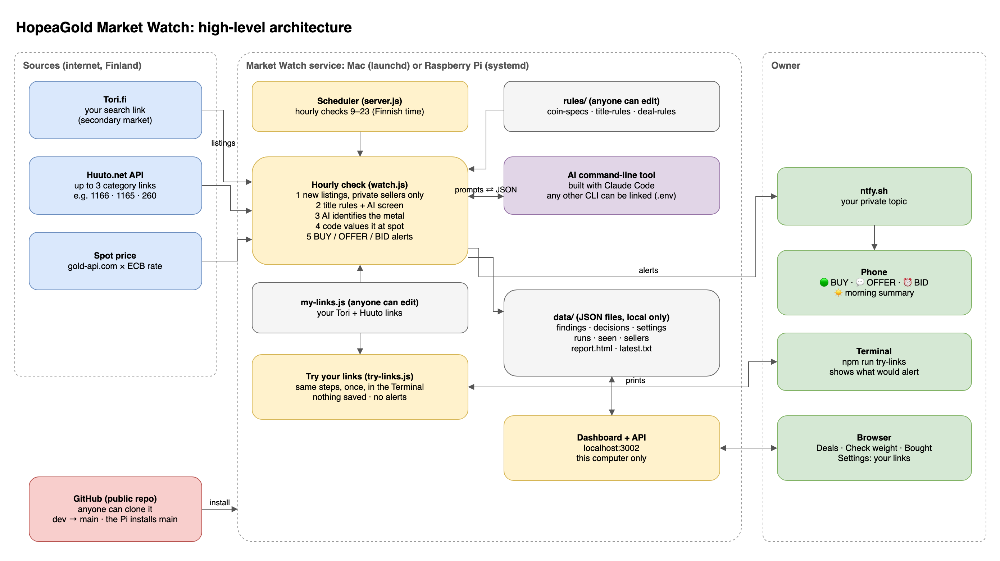

# HopeaGold Market Watch

Finds gold and silver coins listed **below spot** by **private sellers** on Tori.fi and Huuto.net, and tells your phone what to do about each one.

It runs on a **Mac** (background service) or on a **Raspberry Pi** (see [`deploy/raspberry-pi.md`](deploy/raspberry-pi.md)). Only one of them may run it.

> **Built for Finland.** I built Market Watch around the Finnish marketplaces I buy from: **Tori.fi**, Finland's main second-hand market and my secondary market for coins, and **Huuto.net** (online auctions and buy-now). Prices are in euros and the alert texts follow Finnish formats.
>
> **Use it with your own searches:** put your Tori and Huuto links in [`my-links.js`](my-links.js) and test them with `npm run try-links`, which saves nothing and sends no alerts (see [Your links](#your-links)). The rules it decides with are in [`rules/`](rules/README.md), and anyone can update them.
>
> **Using it in your own country:** see [Adding a marketplace from your country](#adding-a-marketplace-from-your-country).

## Architecture



Edit the diagram in [draw.io / diagrams.net](https://app.diagrams.net): open [`docs/architecture.drawio`](docs/architecture.drawio). After a change, export it again as `docs/architecture.png`.

**How it fits together**

- **Sources:** your Tori search link and Huuto category links (from [`my-links.js`](my-links.js) or the dashboard), and the spot price (gold-api.com × the ECB euro rate).
- **Scheduler (`server.js`):** one always-on service (launchd on a Mac, systemd on a Raspberry Pi). It starts the hourly check from 9 to 23 (Finnish time).
- **Hourly check (`src/watch.js`):** reads new listings from private sellers. Fixed title rules and an AI command-line tool on your own account (built with Claude Code; any other can be linked, see [AI tool](#ai-tool)) decide what is gold or silver. Code then values each find at spot against the verified coin table, and picks what to alert. The AI never sets a price.
- **Rules (`rules/`):** the verified coin table, the title rules and the deal rules, kept apart from the code so anyone can update them.
- **Try your links (`try-links.js`):** the same check once, printed in the terminal, saving nothing.
- **Data (`data/`):** plain JSON files on your computer: finds, your decisions, settings, run history, reports. Never uploaded.
- **You:** phone alerts through ntfy, and the dashboard at `http://localhost:3002` on the same computer.
- **Code:** this public GitHub repo. Anyone can clone it and run their own copy. Changes go to `dev` and are merged into `main`; a Raspberry Pi installs from `main`.

The full design is in [`specs/`](specs/README.md).

## What it sends to your phone

Every hour from 9:00 to 23:00 it reads new listings from your two links (below), values the metal at today's spot price in euros, and sends an ntfy alert:

| Alert | When | What to do |
|---|---|---|
| 🟢 **BUY NOW** | Price is below the metal value | Buy it. Max price = metal value |
| 💬 **OFFER** | Up to 20 % over spot and the seller takes offers | Offer 10 % under the metal value, never more than the metal value |
| ⏰ **BID** | An auction in your Huuto link is below spot and closes before the next check | Bid up to the metal value before it closes |
| ☀️ **MORNING** | First check of the day | List of everything still open |

It has its own dashboard at **http://localhost:3002**.

> **Specifications:** [`specs/`](specs/README.md) specifies every part of the system, using the owner's spec templates. A builder can rebuild it from that folder alone.

---

## Your links

Market Watch watches **one Tori search and up to three Huuto searches**. Anyone can put in their own.

**The easy way: [`my-links.js`](my-links.js).** Open it in any text editor and paste your links. The comments explain each line.

```js
tori: 'https://www.tori.fi/recommerce/forsale/search?product_category=2.86.285.138&q=hopea',
huuto: [
  { url: 'https://www.huuto.net/haku?category=1166&sort=newest', category: 1166, metals: ['gold', 'silver'] },
],
```

You can also change them in the dashboard (**Settings → Your links**). The dashboard's saved Settings win over the file for the running service.

### 1. Tori: any Tori search

1. On **tori.fi**, search or filter what you want: category, price, location, words.
2. Copy the full address from the browser bar and paste it as `tori` in `my-links.js`.

The address must start with `https://www.tori.fi/recommerce/forsale/search`. Leave out `sort=`: Tori's robots.txt forbids it, and Market Watch refuses such a link.

### 2. Huuto: up to three category searches

Huuto's data can only be filtered by **category**, so each Huuto search is one category. Open a category on huuto.net, copy the address (it contains `category=<number>`), and choose which metals count in it. A listing with a metal you didn't choose is dropped. Buy-now **and** auction listings both count.

| Search (example) | Category | Metals |
|---|---|---|
| `https://www.huuto.net/haku?category=1166&sort=newest` | 1166 Kultarahat ja -harkot (gold coins and bars) | gold and silver |
| `https://www.huuto.net/haku?sort=newest&category=1165` | 1165 Ulkomaalaiset juhlarahat ja vuosisarjat (foreign commemoratives) | gold and silver |
| `https://www.huuto.net/haku?sort=newest&category=260` | 260 Ulkomaiset kolikot (ei eurot) (foreign coins) | silver only |

### 3. Test your links (nothing saved, no alerts)

```bash
npm run try-links                     # your links from my-links.js, with your AI tool
npm run try-links -- --no-ai          # no AI tool yet? title rules only
npm run try-links -- --tori "https://www.tori.fi/recommerce/forsale/search?q=hopearaha"
npm run try-links -- --huuto "https://www.huuto.net/haku?category=1166" --metals gold
npm run try-links -- --hours 72       # look further back than 24 hours
```

It reads your links once and runs the same steps as the service: private sellers only, rules, AI, valuation at today's spot. Then it prints what the service would alert, ranked by how far below spot: 🟢 BUY NOW, 💬 OFFER, ⏰ auctions, and "check weight first". It writes nothing and sends nothing, so you can run it as often as you like, even while the service is running.

### Adding a marketplace from your country

- **Tori:** one search link, any filters. Paste it in Settings.
- **Huuto:** up to three category links, each with the metals you want. Paste them in Settings.
- **A different site** (for example a marketplace in Sweden, Germany or the US) needs a small reader for its pages before its links can be used: one function in `src/sources.js` that turns a search page into listings (title, price, link, time listed, private or company). Use `fetchTori` and `parseToriPage` as the model, add the site to the hourly check in `src/watch.js`, and add a test with a saved copy of one of its pages (see `test/tori.test.js`). Then its links work like Tori's.
- Check each site's terms and robots.txt first, and keep the pauses between requests.
- Outside the euro area, the spot price is still converted to euros. Change the currency in `src/sources.js` (`getSpot`) and the number formats in `src/report.js`.

---

## Rules (anyone can update them)

Everything Market Watch decides lives in [`rules/`](rules/README.md), apart from the code:

| File | Decides |
|---|---|
| [`rules/coin-specs.js`](rules/coin-specs.js) | Verified weight and fineness of known coins |
| [`rules/title-rules.js`](rules/title-rules.js) | Which titles are a known coin, which words mean gold/silver or "not a coin" |
| [`rules/deal-rules.js`](rules/deal-rules.js) | BUY NOW / OFFER / "unusually cheap" limits, offer discount, auction alert timing |

Change a file, run `npm test`, then `npm run try-links` to see the effect. [`rules/README.md`](rules/README.md) explains how to add a coin. Pull requests with verified coins are welcome.

---

## AI tool

Market Watch asks an AI command-line program to read listing titles and descriptions and say which items are gold or silver and how much metal they contain. Code then checks those answers and does all the pricing.

**Built and tested with [Claude Code](https://docs.claude.com/en/docs/claude-code/overview)** (Anthropic's command-line tool, on a claude.ai subscription). **Any other AI command-line tool can be linked instead**: anything that can answer one question from the Terminal and print the answer. The tool is chosen only in `.env`, so switching needs no code change.

1. Install one and log in to it once in the Terminal.
2. Fill in the `AI_…` lines in `.env` (examples in [`.env.example`](.env.example)):

| Setting | What it is |
|---|---|
| `AI_COMMAND` | Full path of the program (`which <program>`) |
| `AI_ARGS` | Its arguments. `{prompt}` is replaced by the question and `{model}` by `AI_MODEL`. Without `{prompt}`, the question is sent to the program's input |
| `AI_MODEL` | The model name, if `AI_ARGS` uses `{model}` |
| `AI_OUTPUT` | `text` if it prints the answer as plain text, or `json:<field>` if it prints JSON with the answer in `<field>` |
| `AI_ERROR_FIELD` | Optional: a JSON field that is set when the program failed |
| `AI_STRIP_ENV` | Optional: variables to remove before running it (for example API keys, so it uses your subscription login) |

**Examples.** Claude Code is the one Market Watch runs on every day. The others are examples of linking a different tool, not tested here: check each tool's own documentation for its current options.

| Tool | Install and log in | `.env` |
|---|---|---|
| **Claude Code** (built and tested with this) | `curl -fsSL https://claude.ai/install.sh \| bash`, then run `claude` once and log in with your claude.ai account | `AI_ARGS=-p {prompt} --output-format json --model {model} --effort medium --tools "" --strict-mcp-config --settings '{"disableAllHooks":true}'` · `AI_MODEL=claude-sonnet-5-5` · `AI_OUTPUT=json:result` · `AI_ERROR_FIELD=is_error` · `AI_STRIP_ENV=ANTHROPIC_API_KEY,ANTHROPIC_AUTH_TOKEN` |
| Google Gemini CLI | `npm install -g @google/gemini-cli`, then run `gemini` once | `AI_ARGS=-p {prompt} -m {model} --output-format json` · `AI_MODEL=gemini-2.5-pro` · `AI_OUTPUT=json:response` · `AI_ERROR_FIELD=error` |
| OpenAI Codex CLI | `npm install -g @openai/codex`, then `codex login` | `AI_ARGS=exec --skip-git-repo-check -m {model} {prompt}` · `AI_MODEL=gpt-5` · `AI_OUTPUT=text` |
| Ollama (free, runs on your own computer) | install from ollama.com, then `ollama pull llama3.1` | `AI_ARGS=run {model}` · `AI_MODEL=llama3.1` · `AI_OUTPUT=text` |

Each needs `AI_COMMAND` set to the program's full path (for Claude Code usually `~/.local/bin/claude`; find it with `which claude`). With Claude Code, `--tools ""` and `--strict-mcp-config` keep the AI to answering only, `--settings '{"disableAllHooks":true}'` stops your own Claude Code hooks from running on every check, and `AI_STRIP_ENV` makes sure it uses your subscription, never an API key. Smaller local models make more mistakes on Finnish listings; the code checks still stop a wrong weight from becoming an alert (it goes to **Check weight** instead).

Test it with `npm run try-links`: one check, nothing saved, no alerts.

## Requirements

- **macOS 13+** or **Raspberry Pi OS (64-bit)** on a Pi 4 or 5
- **Node.js 18+** (tested on v22). No `npm install` needed: the project has no dependencies.
- An **AI command-line tool**, logged in with your own account: Claude Code (built and tested with it) or any other (see [AI tool](#ai-tool)).
- The **ntfy** app on your phone (free) for the alerts

## Run it from scratch on a Mac (about 20 minutes)

All commands go in the Terminal app.

**1. Get the code**

```bash
git clone https://github.com/ammar93b/hopeagold-market-watch.git ~/Documents/hopeagold-market-watch
cd ~/Documents/hopeagold-market-watch
```

Then put your own searches in `my-links.js` (see [Your links](#your-links)).

**2. Check Node.js, and install an AI tool**

```bash
node --version              # v18 or higher. If missing: install the LTS from https://nodejs.org
# then install one AI command-line tool and log in to it: see "AI tool" below
```

**3. Set up phone alerts**

1. Phone: install **ntfy** → open it → allow notifications.
2. Pick your private topic name (anyone who knows it can read your alerts). Make a new one with:
   ```bash
   echo hopeagold-market-$(openssl rand -hex 5)
   ```
3. Phone: ntfy → **+** → type the topic exactly → **Subscribe** (leave "Use another server" off).
4. iPhone Settings → Notifications → ntfy → allow notifications and sounds, and turn on **Time Sensitive** if shown.

**4. Create the `.env` file**

```bash
cp .env.example .env
open -e .env
```

Set `NTFY_TOPIC=<your topic>` and the `AI_…` lines for your AI tool (see [AI tool](#ai-tool)). Save and close.

**5. Test the phone, then check by hand**

```bash
npm run test-push           # "🪙 Market Watch test" should arrive within seconds
npm run try-links           # one check of your links: nothing saved, no alerts
```

**6. Start the service**

```bash
npm run service:install     # starts at login, restarts itself if it stops
npm run service:status      # should say "Service: running"
npm run open                # opens the dashboard
```

**7. Allow Documents access (one time)**

If macOS asks *"node" would like to access files in your Documents folder*, click **Allow**. Missed it? System Settings → Privacy & Security → Files and Folders → node → Documents Folder **on**, then `npm run service:restart`.

**8. Final check**

Dashboard → **Settings** → **Send test alert**. The header should show "Next check …".

---

## Everyday commands

Run these inside the project folder.

| Command | What it does |
|---|---|
| `npm run open` | Open the dashboard |
| `npm run service:status` | Is it running? |
| `npm run service:restart` | Restart. **Do this after changing code, `.env`, `config.js`, `my-links.js` or `rules/`** |
| `npm run service:install` | Install or reinstall the service (Mac or Raspberry Pi) |
| `npm run service:remove` | Stop it and remove it from starting up |
| `npm run log` | Last 80 lines of the service log |
| `npm run try-links` | Try your links: one check printed in the terminal, **nothing saved, no alerts** |
| `npm run check` | Run one check now, with alerts |
| `npm run dry` | One check without alerts that **does** mark listings as seen (they won't alert later). Prefer `try-links` |
| `npm run test-push` | Send one test alert |
| `npm run summary` | Text summary of the latest results |
| `npm test` | Run the tests |

## Dashboard

http://localhost:3002 (this computer only)

- **Deals**: Category 1 (BUY NOW + OFFER) and Category 2 (auctions in your Huuto link), ranked by % below spot with € saved. Mark each one *Contacted*, *Bought* or *Not interested* so it stops alerting.
- **Check weight**: possible deals where the weight is an AI guess. Type the real grams, fineness and pieces and press Confirm to re-value.
- **Bought & hidden**: history, with Undo.
- **Runs**: every check, with what it scanned and any error.
- **Settings**: **your links** (the Tori link and up to three Huuto searches), run hours, offer range and discount, ntfy topic, morning summary, test alert, "Send open deals to my phone".

## What is not in GitHub

These stay only on your computer (they're in `.gitignore`):

- **`.env`**: your ntfy topic and your AI tool settings
- **`data/`**: Bought history, your decisions, dashboard settings, logs and caches

When moving to another computer, copy these two by hand (for the Pi see `deploy/raspberry-pi.md`). Everything else comes from GitHub.

## Project layout

```
server.js            service: dashboard, API, live updates, hourly scheduler
run.js               one check from the Terminal (--no-push, --test-push)
my-links.js          YOUR Tori and Huuto search links
rules/               rules anyone can update: coin-specs.js, title-rules.js, deal-rules.js
try-links.js         try your links: one check, nothing saved, no alerts
config.js            run hours, timeouts, Huuto category names
src/                 sources (spot, Huuto, Tori), rules, AI, valuation, alerts, ntfy
public/              dashboard (index.html, app.js, style.css)
scripts/service.js   background service: macOS (launchd) or Linux / Raspberry Pi (systemd)
deploy/              Raspberry Pi setup guide
docs/                architecture diagram: architecture.drawio (edit) and architecture.png
test/                tests on saved copies of the live pages (npm test)
specs/               rebuild specifications and verbatim appendices
TEMPLATE.md          spec template for dashboard features
_spec-template.md    spec template for back-end features
```

## Something wrong?

| Problem | Fix |
|---|---|
| No alerts on the phone | Dashboard → Settings → Send test alert. The topic in the app must match `.env` exactly |
| Dashboard won't open | `npm run service:status` → `npm run service:install` → still not: `npm run log` |
| "Port 3002 is already in use" | Stop the other copy of Market Watch, then `npm run service:install` |
| A usage-limit message from the AI tool | Your AI account's limit. It retries at the next check. Fewer run hours in Settings if frequent |
| "Could not start the AI program" / "No AI program set" | Set `AI_COMMAND` (full path) and the other `AI_…` lines in `.env`, then `npm run service:restart` |
| "Tori returned no listing cards" | Tori changed its page, or the link has no results. Check the link; if the link is fine, fix `parseToriPage()` in `src/sources.js` |
| "Remove "sort=" from the Tori link" | Delete `sort=…` from the address in Settings |

**Limits:** shipping isn't included in "below spot", auction prices usually rise near the close, and photos aren't checked (condition, fakes). Always open the listing before you pay. Market Watch never bids or buys for you. This is a price tool, not investment advice.
